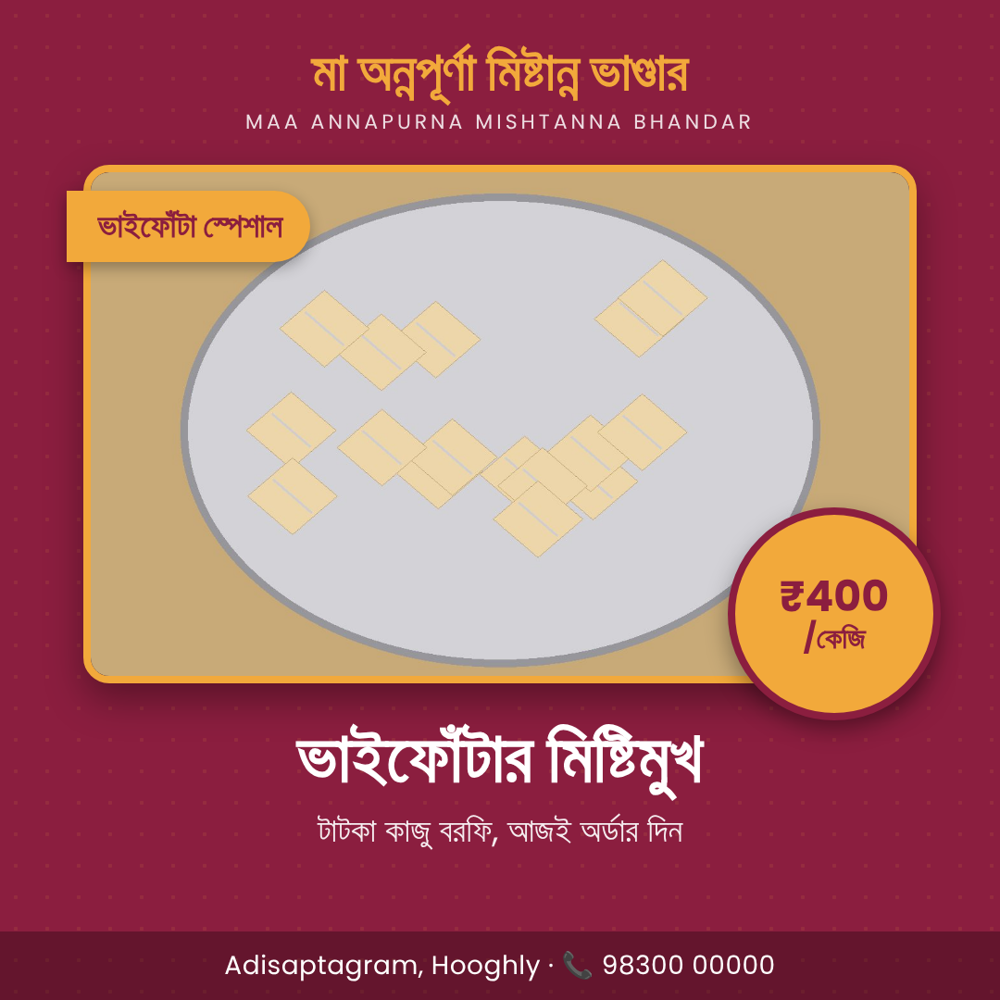

# Dukaan Digital — starter kit

A team of AI agents in n8n that markets a small shop from one photo and a Bengali voice note:
**Listener → Strategist → Copywriter → Designer → owner approves → Publisher**, with an **Analyst** and a **festival nudge** that learn and start conversations.

## Start here (in order)

1. **Keys for hour 0:** n8n Cloud trial, Telegram bot token (@BotFather → `/newbot`), Anthropic API key with a little credit.
2. **Build:** follow `BUILD_GUIDE.md` top to bottom. Each Code node's script is in `n8n/code/`, numbered in flow order.
3. **Get later keys when the guide reaches them:** OpenAI (voice), HTML/CSS to Image (posters), and optionally a Facebook Page token.
4. **Seed data:** create the Data tables from `data/` (instructions in BUILD_GUIDE §1).
5. **Test locally with Claude Code:** open this folder in Claude Code (it reads `CLAUDE.md`), then run `node tools/test_scripts.js`.
   Open `tools/out/poster_test.html` in a browser to see the poster.

## What's in the box

| Path | What it is |
|---|---|
| `BUILD_GUIDE.md` | Node-by-node build of the two workflows, plus a pre-demo checklist and common errors |
| `CLAUDE.md` | Context for Claude Code, including how to generate and validate n8n JSON with n8n-mcp |
| `n8n/code/` | 17 tested Code-node scripts: routing, voice fix, photo, agent requests, JSON parsing, poster, preview, publish, analyst stats, nudge |
| `prompts/` | System prompts for the six agents |
| `templates/poster.html` | 1080×1080 poster design (Bengali via Google Fonts) |
| `data/` | Shop profile, 10 seeded past posts (labelled `seeded_demo`), verified festival dates Nov 2026 – Feb 2027 |
| `tools/` | Generators that embed prompts and the template into the scripts, plus the mock-n8n test runner |

## Design choices worth saying to judges

- **Owner approval before anything is published.** Facts (price, offer) come only from what the owner said.
- **Real product photos only.** Never AI-generated food.
- **Numbers are computed in code.** The Analyst only interprets them, so it can't invent statistics.
- **Festival dates come from a verified list.** The model never guesses them. Poush Sankranti 2027 is marked approximate.
- **Memory:** edits like "less English" become lasting style notes that the next post follows.
- **Seeded engagement history is labelled as demo data.** Live posts are real.
